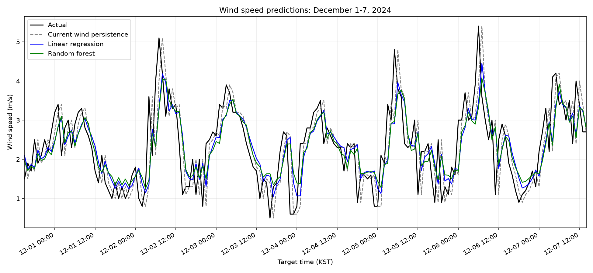

# ASOS 풍속 예측

ASOS 시간별 관측 자료로 다음 1시간의 실제 풍속을 예측하고, 기준 예측·선형 회귀·랜덤 포레스트의 성능을 비교하는 프로젝트입니다. 시각은 모두 한국 표준시(KST, UTC+09:00)로 해석합니다.

## 파일

| 파일 | 설명 |
|---|---|
| `asos_108_2023_2024.csv` | 원본 시간별 관측 자료. 스크립트는 이 파일을 수정하지 않습니다. |
| `asos.py` | 시간 간격에 맞는 입력·정답 데이터셋을 만들고, 모델을 학습·평가하여 예측 결과를 저장합니다. |
| `wind_dataset.csv` | 입력 특성과 정답 풍속으로 구성한 학습·평가용 데이터셋입니다. |
| `predictions.csv` | 2024년 12월 평가 구간의 실제값과 세 가지 예측값입니다. |
| `plot_predictions.py` | 2024년 12월 1~7일 예측 그래프를 만들고 12월 전체 MAE를 출력합니다. |
| `prediction_week.png` | 주간 실제 풍속 및 예측 그래프입니다. |

## 실행

프로젝트 폴더에서 실행합니다.

```powershell
python .\asos.py
python .\plot_predictions.py
```

`asos.py`는 Python 표준 라이브러리만 사용합니다. 그래프 생성을 위해 `matplotlib`가 필요합니다. 아직 설치하지 않았다면 다음을 실행하세요.

```powershell
python -m pip install matplotlib
```

두 스크립트는 같은 폴더의 CSV 파일을 읽고 결과 파일을 해당 폴더에 생성하거나 덮어씁니다.

## 데이터 구성

원본의 관측 시각을 시간순으로 정렬하고, 최초·최종 관측 시각 사이에 매시간 시각을 둡니다. 시간 간격을 맞춘 뒤 현재 시각, 1시간 전, 2시간 전, 정답 시각(현재 시각의 1시간 뒤)에 필요한 관측이나 값이 빠져 있으면 해당 샘플을 제외합니다. 결측값을 보간하거나 채우지 않습니다.

각 샘플의 입력 특성은 다음 5개입니다.

1. 현재 풍속 (`current_wind_speed_ms`)
2. 1시간 전 풍속 (`wind_speed_1h_ago_ms`)
3. 2시간 전 풍속 (`wind_speed_2h_ago_ms`)
4. 현재 기온 (`current_temperature_C`)
5. 현재 습도 (`current_humidity_pct`)

정답은 정확히 1시간 뒤의 실제 풍속 (`actual_wind_speed_ms`)입니다. `wind_dataset.csv`에는 입력 시각(`prediction_time`)과 정답 시각(`target_time`)도 별도 열로 기록합니다.

## 학습 및 평가

샘플을 정답 시각 기준으로 시간순 처리하며, 평가 구간에서 모델을 다시 학습하지 않습니다.

- 학습: 2023년 1월 1일~2024년 11월 30일
- 평가: 2024년 12월 1일~12월 31일
- 이번 데이터의 학습 행수: 16,720
- 이번 데이터의 평가 행수: 744

평가 방법:

- **현재 풍속 유지 기준**: 현재 풍속을 다음 1시간의 예측값으로 사용합니다.
- **선형 회귀**: 5개 입력 특성으로 최소제곱 선형 회귀를 학습합니다. 음수 예측은 0으로 바꿉니다.
- **랜덤 포레스트**: 100개 회귀 트리의 평균입니다. 학습 표본을 복원 추출하고, 각 분기에서 무작위로 고른 2개 특성의 분할을 평가합니다. 최대 깊이는 6, 리프당 최소 표본은 5, 무작위 시드는 42입니다. 음수 예측은 0으로 바꿉니다.

랜덤 포레스트는 스크립트에 포함된 구현이며 `scikit-learn`에 의존하지 않습니다. 시드는 동일 입력에 대해 반복 실행 결과가 재현되도록 합니다.

## 현재 데이터의 평가 결과

2024년 12월 전체 744개 평가 행에서 계산한 평균 절대 오차(MAE)입니다.

| 방법 | MAE (m/s) |
|---|---:|
| 현재 풍속 유지 | 0.653495 |
| 선형 회귀 | 0.594577 |
| 랜덤 포레스트 | 0.591341 |

랜덤 포레스트 MAE는 현재 풍속 유지 기준보다 0.062154 m/s, 선형 회귀보다 0.003236 m/s 낮았습니다. 원본 데이터가 바뀌면 행수와 성능 결과도 달라질 수 있습니다.

## 그래프

그래프는 정답 시각이 2024년 12월 1일 00시부터 12월 7일 23시까지인 168개 행을 사용합니다. MAE는 주간 데이터가 아니라 12월 전체 평가 행으로 계산합니다.


